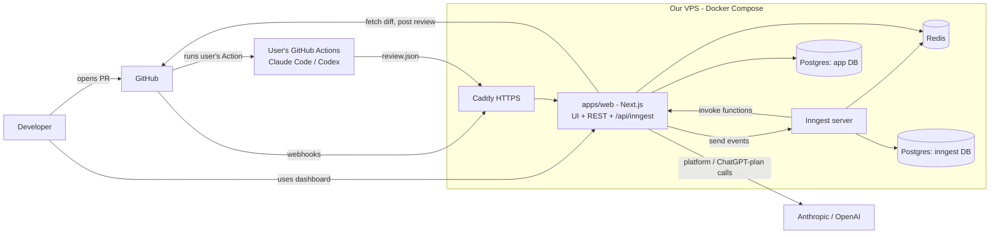
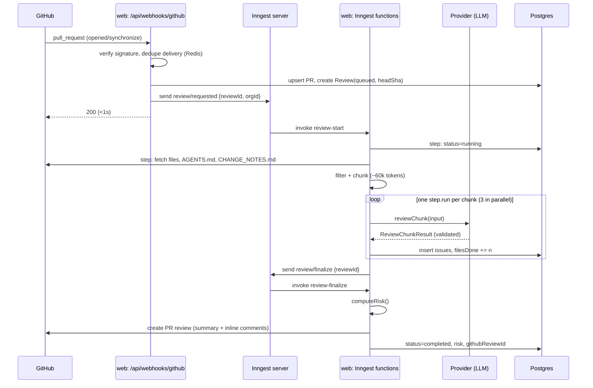
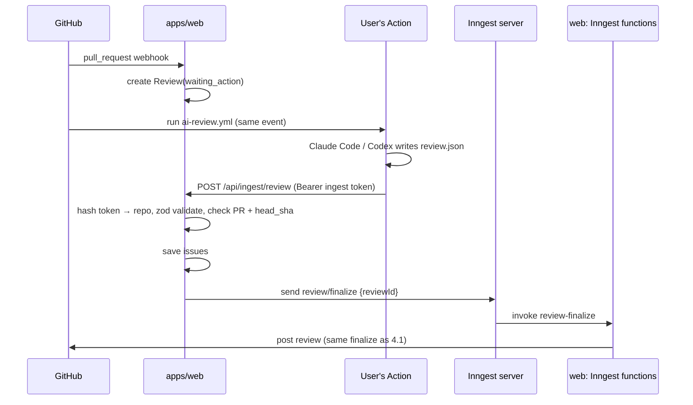
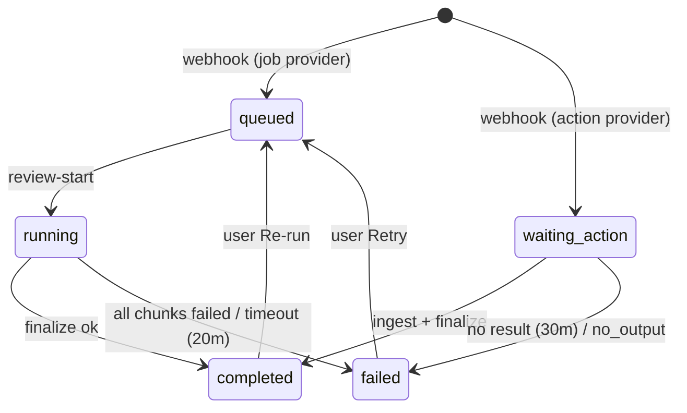
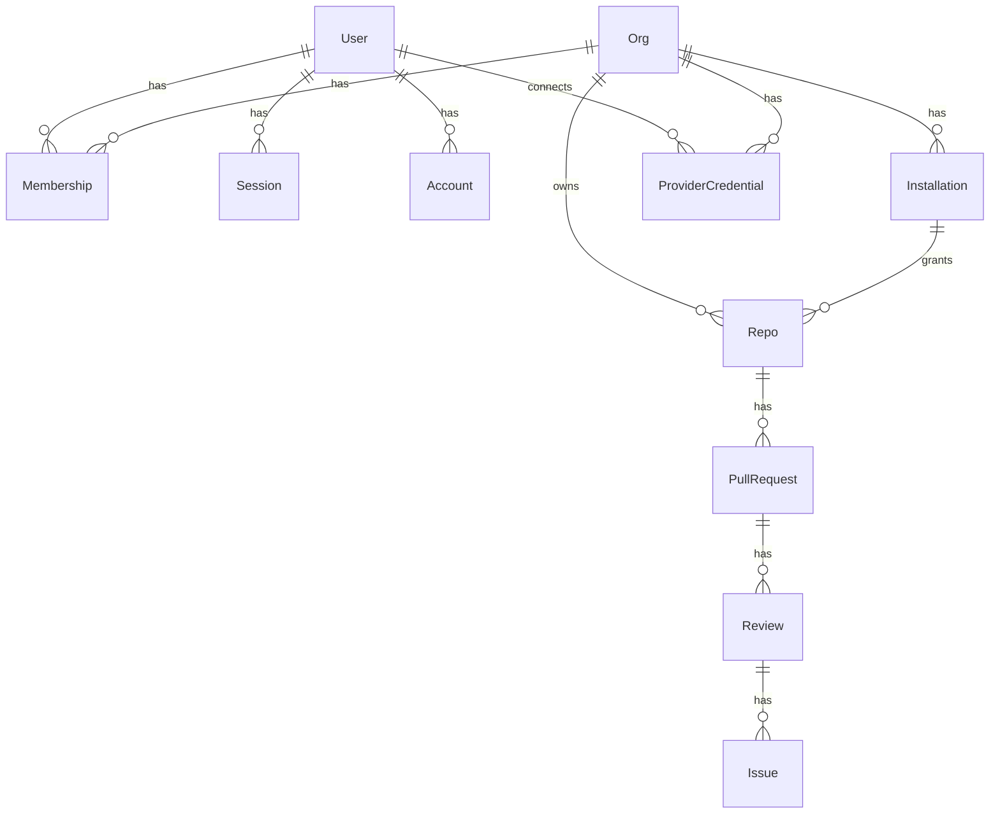

# Architecture — AI Code Review Platform

Full technical design. For the one-page version agents should load first, see
`docs/essential-architecture.md`. Product requirements: `docs/prd.md`. Stack decisions:
`docs/tech-stack.md` (wins over this file if they disagree).

---

## 1. System context



## 2. Components

| Component | Tech | Responsibility |
|---|---|---|
| `apps/web` | Next.js App Router + React, Tailwind + shadcn/ui, TanStack Query, Better Auth | The one app: UI, GitHub login + orgs, dashboard REST API, settings, setup wizard, ChatGPT OAuth routes, webhook route, ingest route, `/api/inngest` |
| `apps/web/src/server/github` | Next.js route handler | Webhook handling (lane A) |
| `apps/web/src/server/ingest` | Next.js route handler | Action result ingest (lane D) |
| `apps/web/src/server/jobs` | Inngest functions | Run reviews (chunking, provider calls), finalize (score + comments), sweep stuck reviews (lane B) |
| Inngest server | `inngest/inngest` (self-hosted) | Event bus, scheduling, step state, retries, run history UI |
| `packages/shared` | TS + zod | Contracts: enums, `ReviewResult` schema, provider interface, Inngest event schemas, REST API schemas, crypto |
| `packages/db` | Prisma | Schema, migrations, client |
| `packages/github` | Octokit | App auth, installation tokens, PR/file fetch, webhook signature check |
| `packages/providers` | Anthropic/OpenAI SDKs | Prompt builder, provider implementations, output parsing, ChatGPT OAuth helpers |
| `packages/scoring` | TS | Risk formula |
| `packages/github-comments` | TS | Diff-line mapping, comment formatting, posting reviews |
| `packages/workflow-templates` | TS | Render Claude/Codex Action YAML, open setup PR |
| Infra | Docker, Caddy, Postgres 16, Redis 7 | Single VPS, auto HTTPS, backups |

Dependency rule: apps depend on packages; packages depend only on `shared`/`db` and each other's
public `index.ts`; no package depends on an app. Inside `apps/web`, lane folders import each other only
through their `index.ts` (`@/server/jobs`, `@/server/github`, `@/server/ingest`).

## 3. Provider modes

| `ProviderId` | `runsInWorker` (= runs in our Inngest functions) | Credential location | Result path |
|---|---|---|---|
| `platform` | yes | Our env (`ANTHROPIC_API_KEY` / `OPENAI_API_KEY`) | Inngest function → DB |
| `codex_chatgpt` | yes | `ProviderCredential` (encrypted OAuth token from Sign in with ChatGPT) | Inngest function → DB |
| `claude_action` | no | User's repo secret `CLAUDE_CODE_OAUTH_TOKEN` (never reaches us) | Action → `/api/ingest/review` |
| `codex_action` | no | User's repo secret `OPENAI_API_KEY` (never reaches us) | Action → `/api/ingest/review` |

All four produce `ReviewResult` (schema v1). Everything after that is shared.

## 4. Main flows

### 4.1 Job-run review (`platform`, `codex_chatgpt`)

Step outputs are stored by Inngest, so steps return ids/counts only — never patches or AI text.

### 4.2 Action-run review (`claude_action`, `codex_action`)


### 4.3 Sign in with ChatGPT
`/api/oauth/chatgpt/start` (web) → OpenAI authorize → `/api/oauth/chatgpt/callback` →
`chatgptOAuth.exchangeCode()` → `encrypt()` tokens → `ProviderCredential`. The provider refreshes on expiry
(inside the Inngest step) and saves back encrypted. Exact endpoints/scopes: verify against OpenAI's current developer docs.

### 4.4 Setup wizard: commit workflow
Web calls `openWorkflowPR()` (`@app/workflow-templates`) with an installation Octokit → branch
`ai-review/setup` → `.github/workflows/ai-review.yml` → PR listing required secrets.

## 5. Review state machine


`stale` is derived, not stored: `review.headSha !== pullRequest.headSha`.

### Error codes
| Code | Cause | User-facing fix |
|---|---|---|
| `too_large` | Over token budget (warning on completed, or failure) | Split PR / reviewed riskiest files |
| `provider_auth` | 401/403 from provider | Renew Claude token / reconnect ChatGPT |
| `rate_limited` | 429 / plan cap | Retry later / switch provider |
| `timeout` | Call > 90s or review > 20m | Retry |
| `action_missing` | No ingest in 30m | Check Action logs / secrets |
| `invalid_output` | AI JSON invalid after retry, or `no_output` | Retry |
| `github_error` | GitHub API failure | Retry; check app installation |
| `internal` | Bug | Contact support with review id |

## 6. Data model

Auth tables come from **Better Auth** (Prisma adapter): `User`, `Session`, `Account`, `Verification`, and
from the organization plugin `Organization` (= our **Org**), `Member` (= our **Membership**, roles
owner|admin|member) and `Invitation`. We add our own fields to them (Better Auth `additionalFields`).
The GitHub user id comes from the `Account` row (`providerId = 'github'`).



Key fields:
- **Repo:** `provider`, `settings` (JSON, `RepoSettingsSchema`), `ingestTokenHash`, `active`
- **PullRequest:** `number`, `state`, `headSha`, `baseRef`, `additions`, `deletions`, `changedFiles`
- **Review:** `headSha`, `provider`, `status`, `errorCode`, `errorMessage`, `filesTotal`, `filesDone`,
  `riskScore`, `riskLevel`, `riskFactors`, `summary`, `githubReviewId`, timestamps.
  Unique: `[pullRequestId, headSha, provider]`
- **Issue:** `file`, `line`, `severity`, `category`, `title`, `explanation`, `suggestedFix`, `posted`
- **ProviderCredential:** `encryptedToken`, `encryptedRefreshToken`, `expiresAt`

Not stored: source code, patches, prompts, raw AI responses (log only sizes/ids).

## 7. Interfaces

All HTTP is REST route handlers in `apps/web/src/app/api/**/route.ts`. Every request/response shape is a
zod schema in `packages/shared/src/api/<area>.ts`. Errors: `{ error: { code, message } }`.

### Public HTTP (called by GitHub / Actions / Inngest, not the browser)
| Method | Path | Auth | Notes |
|---|---|---|---|
| POST | `/api/webhooks/github` | HMAC `X-Hub-Signature-256` | Events: `installation`, `installation_repositories`, `pull_request`, `issue_comment` |
| POST | `/api/ingest/review` | `Bearer rit_…` (hashed lookup) | Body `ReviewResult` ≤ 1 MB; 202 / 400 / 401 / 409 / 413 / 429 |
| GET | `/api/health` | none | |
| GET/POST/PUT | `/api/inngest` | Inngest signing key | Inngest SDK `serve()` |

### Dashboard API (Better Auth session + org membership check)
| Method | Path |
|---|---|
| GET | `/api/repos` |
| GET | `/api/repos/:repoId/pulls?state=open\|closed\|all` → `PullListItem[]` |
| GET | `/api/repos/:repoId/pulls/:number` → PR + latest `ReviewDetail` |
| POST | `/api/reviews/:id/retry`, `/api/repos/:repoId/pulls/:number/rerun` (`{provider?}`) |
| GET/PUT | `/api/repos/:repoId/settings` |
| POST | `/api/repos/:repoId/ingest-token/rotate` → token shown once |
| POST | `/api/repos/:repoId/setup/workflow-pr` |
| GET | `/api/orgs/:orgId/overview?range=30d\|90d` |
| GET | `/api/oauth/chatgpt/start`, `/api/oauth/chatgpt/callback`; DELETE `/api/connections/chatgpt` |
| * | `/api/auth/*` (Better Auth handler) |

### Inngest events and functions
Event names + zod payload schemas: `packages/shared/src/events.ts`.

| Function | Trigger | Producer | Settings |
|---|---|---|---|
| `review-start` | event `review/requested` `{ reviewId, orgId }` | webhook (A), dashboard retry/rerun (F) | concurrency 3 per `orgId`; one `step.run` per chunk |
| `review-finalize` | event `review/finalize` `{ reviewId }` | `review-start` (B), ingest (D) | idempotent on review status |
| `review-sweep` | cron `*/5 * * * *` | Inngest scheduler | — |

Retries: `timeout` / `rate_limited` ×2, `invalid_output` ×1, `provider_auth` ×0 (`NonRetriableError`).
Payloads carry ids only.

### Provider interface
`ReviewProvider.reviewChunk(ReviewChunkInput, ProviderContext) → ReviewChunkResult`;
throws `ProviderError(code)`. Defined in `packages/shared/provider.ts`.

## 8. Review pipeline details
1. **Filter:** removed/binary files, `ignorePaths`, secret-like files (`.env*`, `*.pem`, `*.key`), lockfiles.
2. **Context:** PR title/body, `CHANGE_NOTES.md`, `AGENTS.md` at head SHA.
3. **Chunk:** est. tokens = chars/4; pack ≤ 60k; oversize file → first hunks + note; total > 400k →
   prioritize sensitive paths, mark `too_large` warning.
4. **Call:** one Inngest `step.run` per chunk, 3 in parallel; 90s timeout; retries: timeout/rate_limited ×2,
   invalid_output ×1, auth ×0 (`NonRetriableError`).
5. **Validate:** extract JSON, zod parse; drop issues not in diff.
6. **Score:** `computeRisk` (weights in `packages/scoring/src/weights.ts`):
   AI max × 0.4 + issue severity (cap 40) + size + sensitive paths + missing tests → 0–100.
7. **Post:** one GitHub review (`COMMENT`), ≤ 50 inline comments, `suggestion` blocks, escaped markdown,
   mentions neutralized; prior bot summary marked outdated.

## 9. Security
| Area | Control |
|---|---|
| Webhooks | HMAC SHA-256 over the raw body, timing-safe compare, delivery dedupe (Redis, 24h) |
| Inngest | `/api/inngest` verified with `INNGEST_SIGNING_KEY`; Inngest dashboard not public (SSH tunnel only) |
| Sessions | Better Auth (`BETTER_AUTH_SECRET`), HTTP-only cookies |
| Ingest | Per-repo random token (`rit_`), stored as SHA-256 only, rotatable, rate-limited 30/h |
| User credentials | Claude/OpenAI keys for Actions never touch platform; ChatGPT tokens AES-256-GCM |
| Tenant isolation | Every dashboard query scoped by org membership |
| AI output | Untrusted: schema validation, length caps, markdown/HTML escaping, diff-line check |
| Data minimization | No code/patch/prompt storage; no secrets in logs |
| Transport | HTTPS only (Caddy, HSTS); internal services not exposed |
| Server | SSH keys only, UFW 22/80/443, unattended upgrades, fail2ban, non-root containers |
| GitHub App permissions | Pull requests R/W, Contents R, Checks R/W, Metadata R, Issues R |

## 10. Deployment

```
VPS (Ubuntu LTS)
└── docker compose (infra/compose.prod.yml)
    ├── caddy        :80/:443  → auto Let's Encrypt, everything → web:3000
    ├── web          :3000     (Next.js: UI + API + Inngest functions)
    ├── inngest      :8288     (self-hosted Inngest; dashboard via SSH tunnel only)
    ├── migrate      one-shot  (prisma migrate deploy)
    ├── postgres     volume    (DBs: app, inngest)
    └── redis        volume, AOF
```
- CI (`.github/workflows/ci.yml`): lint, typecheck, test, build on every PR.
- CD (`deploy.yml`): build → push GHCR (sha tags) → SSH → `compose pull && up -d` → healthcheck →
  rollback on failure.
- Backups: nightly `pg_dump`, 7 daily + 4 weekly, optional off-site S3.

## 11. Observability
- Structured logs (pino) with `reviewId`, `repoId`, `orgId`; rotated container logs.
- Health endpoints for uptime monitor; optional Sentry.
- Key metrics (from DB): reviews by status/provider, duration p50/p95, error code counts.
- Inngest dashboard: run history, step retries, backlog per function.

## 12. Scaling path
| Stage | Change |
|---|---|
| Now | Single VPS, one `web` container + `inngest` |
| More load | Scale `web` replicas (Inngest spreads function calls); move Postgres to managed DB |
| Bigger | Separate `web` deployment just for `/api/inngest` traffic; Redis managed; CDN for web |
| Enterprise | Per-tenant concurrency/rate limits (Inngest keys); GitHub Enterprise Server support |

## 13. Key decisions
| # | Decision | Reason |
|---|---|---|
| D1 | One `ReviewResult` schema for all providers | Consistent scoring, comments, UI; providers swappable |
| D2 | Claude-plan reviews run in the user's Action, never on our servers | Anthropic restricts consumer-plan credentials to its own tools |
| D3 | Codex-plan reviews via Sign in with ChatGPT in our Inngest functions | Officially supported for third-party apps; zero setup for user |
| D4 | Our GitHub App posts comments (not the agent in the Action) | Same formatting and filtering for every provider |
| D5 | One Next.js app for UI + REST + webhooks + ingest (no Fastify/Nest, no tRPC) | Backend is small; one deployable, no CORS/cross-domain auth; REST + zod is ready for a public API |
| D6 | Inngest (self-hosted) instead of BullMQ | Durable steps, step-level retries, per-org concurrency, run history UI |
| D9 | Better Auth instead of Auth.js | Built-in organizations, members and roles for multi-tenant |
| D7 | Don't store code | Trust + lower compliance burden |
| D8 | Chunk per file group | Large PRs (100+ files) otherwise exceed context/timeouts |
